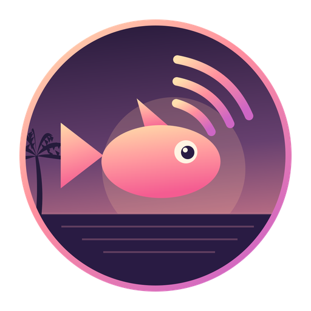

# TackleCast

  

**Play your console on your PC screen.**

TackleCast is a lightweight capture card viewer for Windows and Linux. Connect your console through a USB capture card, open TackleCast, and play in a window or fullscreen, with sound through your PC's speakers or headphones.

Built for playing rather than managing a stream, it keeps your game front and center and puts picture, sound, and display settings a press of Escape away.

## What you can do

- **Play on your existing setup.** Use capture cards such as the Genki ShadowCast, Elgato, AVerMedia, and other compatible USB capture devices.
- **Make the picture your own.** Adjust brightness, contrast, saturation, gamma, and scaling while previewing the result.
- **Choose where you listen.** Select your capture card's audio and your preferred speakers or headphones, with volume and mute controls in the app.
- **Try smoother motion.** Optional frame generation on Windows adds intermediate frames, turning supported 30 FPS capture into 60 FPS output.
- **Keep the screen clean.** Choose a compact performance readout, customize the statistics you see, or hide them altogether.
- **Pick your look.** Switch between the Vice and Classic themes. TackleCast remembers your settings for next time.

## Getting started

You'll need a PC, a compatible capture card, and an HDMI source such as a console. Available resolutions and frame rates depend on your source, card, USB connection, and PC.

1. Download the package for your system from [Releases](../../releases).
2. Extract the entire archive. On Windows, open **TackleCast.exe**; on Linux, run **run.sh** from a terminal.
3. Connect your console to the capture card over HDMI, then connect the card to your PC over USB.
4. Press **Escape** to open settings. In **Video**, choose your capture card, resolution, and frame rate. **Auto** is a good starting point for Pixel Format.
5. In **Audio**, check the capture input and choose your speakers or headphones. Select **Apply & close**, then press **F11** if you'd like fullscreen.

Keep the extracted files together: the app uses the libraries and, where included, frame-generation models shipped with the package.

## Everyday controls

| Action | Control |
|---|---|
| Open or close settings | Escape |
| Toggle fullscreen | F11 |
| Save settings and return to your game | Apply & close |
| Rediscover a reconnected capture card or audio device | Reinitialize devices |

Settings are grouped into **Video**, **Picture**, **Audio**, **Frame Gen**, and **Display**. Picture adjustments preview live; closing the menu saves your choices and applies device changes.

## Frame generation

Some console games run at 30 FPS. TackleCast's optional frame generation creates an extra frame between captured frames to make motion look smoother at 60 FPS. It starts **off**; you can enable it in the **Frame Gen** tab on Windows.

Frame generation changes how motion looks, not how quickly the game responds. It uses additional GPU resources, adds delay, and can produce visual artifacts during fast movement. Leave it off if you prefer the original presentation or prioritize responsiveness. Performance depends on your GPU and capture resolution.

[Watch the Red Dead Redemption 2 preview on PS5 Pro](https://youtu.be/O4NeOv-G_KU).

## Compatibility and help

TackleCast runs on Windows and Linux. Frame generation is Windows-only and requires a compatible DirectX 12 GPU. NVIDIA hardware can also accelerate MJPEG decoding on Windows; other supported configurations use software decoding.

Linux release archives target x86_64 Ubuntu 24.04 or newer and require working desktop audio and graphics drivers. Capture-card compatibility varies, and physical hardware testing has been broader on Windows.

If the picture or sound is missing, check your HDMI and USB connections and the selected video/audio devices, then try **Reinitialize devices**. Some consoles require HDMI content protection to be disabled for gameplay capture. For example, on PS4, clear **Settings > System > Enable HDCP**; stereo **Linear PCM** audio is a useful compatibility starting point.

For bugs or feature requests, [open an issue](https://github.com/SaltedByte/TackleCast/issues). Include your capture-card model, operating system, chosen capture mode, and the latest file from the app's **logs** folder.

## Acknowledgments

- **[Wiktor Stawski (@wiktorstawski)](https://github.com/wiktorstawski)** — Frame-generation implementation and research, contributed in [PR #28](https://github.com/SaltedByte/TackleCast/pull/28).
- **[@NeverForgetful](https://www.youtube.com/@NeverForgetful)** — Testing and QA.
- **[@ajmine03](https://github.com/ajmine03)** — Linux support and audio contributions.
- **[@Vinny-TS](https://github.com/Vinny-TS)** — Capture settings, color controls, and settings UI contributions.

## For contributors

See [BUILD.md](BUILD.md) for building, testing, and packaging, and [the frame-generation notes](README-FrameGen.md) for the implementation background.

## License

TackleCast is open source under the [MIT license](LICENSE). Bundled third-party components retain their respective licenses.
