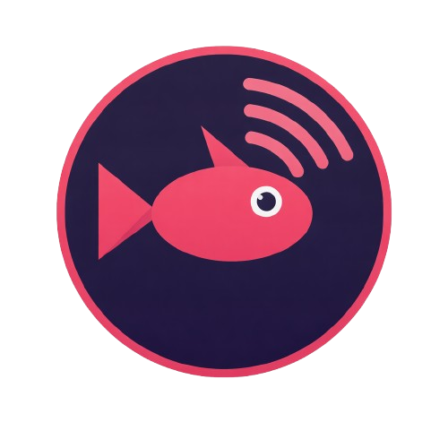

# TackleCast

<p align="center">
  
</p>

**A lightweight, GPU-accelerated capture card viewer for Windows and Linux.** No recording, no bloat, just your game on your screen.

Built for capture cards like the Genki ShadowCast, Elgato, AVerMedia, and other UVC-compliant devices. Written in Rust with a GPU-accelerated video pipeline and low-latency audio passthrough.

## Features

- **GPU-accelerated rendering** via wgpu with a custom YUV-to-RGB shader
- **NVIDIA GPU MJPEG decode on Windows** via nvJPEG/CUDA (automatic fallback to software decode)
- **Zero-copy MJPEG pipeline on supported NVIDIA/Windows systems** - decoded frames stay on the GPU (CUDA to DX12 to wgpu)
- **Native NV12 GPU capture on Windows** via Media Foundation for supported modes, with automatic DirectShow fallback
- **Low-latency audio passthrough** via WASAPI (Windows) and ALSA, including PipeWire/PulseAudio compatibility plugins (Linux)
- **Robust audio resampling & channel conversion** - handles mono, stereo, and variable sample rates (e.g. PS4/PS5/Switch audio over USB capture cards)
- **Audio mute toggle & UI status** - mute control with real-time audio connection status
- **Cross-platform video capture** - DirectShow on Windows, V4L2 on Linux
- **Device-supported modes** - resolutions, pixel formats, and frame rates reported by the selected card, including fractional rates
- **Visible format negotiation** - Auto prefers NV12, then MJPEG at the selected resolution and FPS, and shows the format actually opened
- **Color controls** - metadata-aware color space and range, with explicitly labeled defaults and manual overrides
- **Live picture controls** - brightness, contrast, saturation, gamma, and reset
- **Live FPS counter** with separate nominal and delivered frame rates
- **Auto-detect capture cards** via DirectShow and V4L2
- **Elgato 4K X card settings** on Windows - EDID profiles (e.g. Switch 2 VRR or the PS5 default) or an EDID file, HDMI color range, EDID mode, audio input and HDR tone mapping, using an installed Elgato Studio's device library
- **Four-tab settings** - Video, Picture, Audio, and Display, retaining the coral/navy theme
- **Fullscreen support** (F11 or toggle in settings)
- **Zero recording overhead** - purely a viewer
- **Settings persistence** - remembers your device selections
- **Diagnostic logging** - rotating log files for troubleshooting

## Quick Start

1. Download the latest release from [Releases](../../releases/latest).
   - **Windows**: Download `TackleCast-Windows-x86_64.zip`, extract anywhere, and double-click `TackleCast.exe`.
   - **Linux**: Download `TackleCast-Linux-x86_64.tar.gz`, extract (`tar -xzvf TackleCast-Linux-x86_64.tar.gz`), and run `./run.sh`.
2. Press **Escape** and choose your capture card under **Video**. Select a supported resolution and frame rate; leave Pixel Format on Auto or choose a supported format manually.
3. Close the menu with **Escape** to apply capture changes. Auto then shows the opened format, such as `Auto (NV12)`. Press **F11** for fullscreen.

FFmpeg is bundled on both platforms. Windows packages also include the CUDA/nvJPEG runtime; GPU decoding needs a compatible NVIDIA GPU and driver. Official Linux archives target x86_64 Ubuntu 24.04 or newer and use your desktop's ALSA and Vulkan/OpenGL drivers.

On Linux/X11, your desktop must also provide the X11 keyboard runtime. On Ubuntu/Debian, install it if needed with `sudo apt install libxkbcommon-x11-0`.

### PS4 audio and video

Connect the PS4's HDMI output to your capture card and the card to your PC over USB. For gameplay capture, clear **Settings > System > Enable HDCP** ([PlayStation guide](https://manuals.playstation.net/document/en/ps4/settings/hdcp.html)). Set **Settings > Sound and Screen > Audio Output Settings > Audio Format (Priority)** to **Linear PCM** ([PlayStation guide](https://manuals.playstation.net/document/en/ps4/settings/audiooutput.html)).

In TackleCast, press Escape and select the capture card's audio input and your speakers/headphones as output. Check that audio is Connected and unmuted. Mono input is duplicated to stereo, and different input/output sample rates are converted. For the widest capture-card compatibility, use stereo PCM; surround conversion assumes the conventional speaker order described in [BUILD.md](BUILD.md).

Audio input **Auto (follow video)** uses a unique name match for the selected video device. Without a unique match, audio stays disconnected; it never substitutes another capture card or your system microphone. Select an explicit input to use audio independently of video. If sound is missing, select the capture card's input and inspect the input/output formats in `logs/`. Unit tests cover routing, channel conversion and resampling; console-specific behavior still depends on the card and needs hardware validation.

### Elgato 4K X settings and EDID (Windows)

When an **Elgato 4K X** is selected, the Video tab adds two sections with the card settings Elgato Studio offers, so you don't need Studio open. Other capture cards never see them, and a setting only appears if the card reports supporting it.

**Elgato 4K X** applies each change as soon as you pick it; the card stays connected:

| Setting | Options |
|---|---|
| HDMI color range | Auto, Expand (limited to full), Shrink (full to limited). This is the card's own conversion, separate from TackleCast's **Color Range**, which only sets how the picture is interpreted. |
| Input EDID mode | Internal (the card's EDID), Display (the pass-through monitor's EDID), Merged. Asks for confirmation: the console renegotiates HDMI, and the picture on TackleCast and a pass-through monitor can stay black until you undock and redock the console (or replug its HDMI cable). |
| Audio input | HDMI audio, Analog line in, plus line-in gain |
| HDR tone mapping | Convert HDR input to SDR on the card |

It also shows whether the HDMI input is HDR. These settings are stored on the card.

**Elgato EDID** shows the EDID active on the card and writes another one: one of Elgato's profiles, such as **4K X Switch 2 VRR** (Elgato's fix for Switch 2 freezes with VRR) or the default **Game Capture 4K X** for PS5; an EDID Elgato Studio saved; or any EDID file with **Load EDID file…**. Choose one, select **Apply EDID…**, then **Write EDID**. With **Input EDID mode** set to Display and a pass-through monitor connected, the console may see the monitor's EDID instead.

Elgato Studio doesn't toggle a preset on the 4K X: it writes a whole EDID file into the card's flash. TackleCast does the same through Studio's own device library, so:

- **Elgato Studio must be installed**, because its device library makes the changes. TackleCast copies that library to `%LOCALAPPDATA%\TackleCast\elgato-edid\` (Windows won't let other apps load it from Studio's folder) and never ships Elgato's files. The Microsoft Store keeps Studio, and so the library, up to date.
- **Close Elgato Studio before changing anything.** TackleCast refuses to change the card while Studio holds it.
- **Writing an EDID stops video and audio for about 20 s** while the card is re-flashed and reconnects; capture restarts by itself. Don't unplug the card until video returns.

**Elgato's EDID list and files come from Elgato.** When a 4K X is selected and the menu reads the card, TackleCast checks Elgato's update service (`gc-updates.elgato.com`, the same one Studio uses) for the current EDID list, at most once a day. It downloads any EDID file the 4K X needs from Elgato's CDN (`edge.elgato.com`). These are the only network requests TackleCast makes; they carry no information about you, and nothing is sent unless a 4K X is selected. Without a connection, TackleCast uses the copy it saved last time, or Studio's. The list also tells TackleCast which USB product IDs belong to a 4K X, so a new revision is recognized without an update.

Every Elgato profile is checked against the SHA-256 in Elgato's EDID list, both when it is downloaded and before it is written. A file you load must be a well-formed EDID (one to four 128-byte blocks, a valid header and a valid checksum on every block); TackleCast keeps a copy in `user-edids\` and lists it next time. After a write, the card is re-read to report the result. Elgato's library runs in a separate helper process, so a fault in it can't take down the viewer.

**After an Elgato Studio update**, check that TackleCast still works with its library. This doesn't touch any card:

```powershell
.\TackleCast.exe --elgato-edid selftest | Out-String
```

It reports whether every library function TackleCast uses is still there, and whether Elgato's EDID list and the 4K X's EDID files are available. The report is also saved as `selftest.txt` in the folder above, and the exit code is 0 when everything passed. Studio's library is private and undocumented, so an update could change it; TackleCast then shows "This Elgato Studio version is not supported" instead of changing the card, and the self-test names the missing functions.

## Building from Source

See [BUILD.md](BUILD.md) for platform dependencies, environment setup, tests, and packaging. After setting up the dependencies:

```bash
cargo build --release
```

## Controls

| Action | Key |
|---|---|
| Open/close settings | Escape |
| Fullscreen | F11 |

## Settings

Press **Escape** to open the four-tab menu. Shorter tabs keep the same menu size and position; small windows can scroll.

| Tab | Controls |
|---|---|
| Video | Capture device, supported resolution/FPS/format combinations, scaling filter, color space, and color range; Elgato 4K X settings and EDID on Windows |
| Picture | Live brightness, contrast, saturation, and gamma adjustments, plus Reset Picture to Defaults |
| Audio | Input/output devices, mute, volume, and connection status |
| Display | Fullscreen, performance overlay, detailed scaling/color information, and Exit |

Picture, scaling, and color adjustments preview immediately. The backdrop clears while editing sliders or their numeric values so you can judge the live picture. Closing the menu saves the settings and applies capture/audio device changes.

The overlay separates the selected **nominal FPS** from **delivered FPS**. For example, a `59.94` nominal mode stays distinct from `60`, even when the short-term delivery counter is close to 60. Auto color labels include `default` when metadata is missing; manual overrides are available when the source's reported color information needs correcting.

## How It Works

For MJPEG capture, TackleCast has a three-tier decode pipeline that automatically selects the best path for your hardware:

| Tier | Path | When |
|---|---|---|
| Zero-copy | nvJPEG decode to shared DX12 buffer to wgpu | NVIDIA GPU with CUDA support (Windows) |
| GPU decode + readback | nvJPEG decode to host memory to wgpu | CUDA available, DX12 interop unavailable |
| Software decode | ffmpeg CPU decode to wgpu | Linux or no CUDA/nvJPEG available |

Auto selects a format from the card's supported modes at the requested resolution and frame rate. It tries NV12 first, then MJPEG, then other supported formats. Manual format selections are strict; capture does not silently reduce resolution or frame rate. The menu shows the actual format after negotiation. The overlay distinguishes the nominal mode from measured frame delivery.

Native NV12 capture retains the FFmpeg frame allocation through the latest-frame
buffer and stages Y and interleaved UV directly from their original row strides.
This avoids an application pixel copy, chroma splitting, and row repacking.
It still uses CPU-backed capture memory and wgpu upload staging; it is not
end-to-end zero-copy capture or a GPU-surface capture backend.

The experimental MF GPU backend receives GPU-backed NV12 surfaces and
uses a bounded GPU-buffer pool. Auto color follows the negotiated native YUV
matrix and full/limited range when provided; missing metadata remains labeled
as a default, and manual color controls override it. Explicit non-NV12 format
selections use the existing capture path. When the native bridge DLL is bundled
beside TackleCast.exe, this backend is selected automatically for eligible modes.
If it fails, or delivers no frames within five seconds of opening, capture
retries through DirectShow. No wrapper script is required;
see `scripts/MF_GPU_SETTINGS_AUDIT.md` for its controls and limitations.

Color Auto follows stream/frame metadata. When metadata is missing, the UI labels the fallback as a default rather than presenting it as detected information. BT.2020 selects a conversion matrix; it does not implement HDR tone mapping.

## Architecture

```
src/
  main.rs          - winit event loop, app state, settings
  capture.rs       - DirectShow / V4L2 capture via ffmpeg-next, strict mode negotiation
  capabilities/    - Native DirectShow / V4L2 mode discovery
  frame_rate.rs    - Rational nominal frame rates
  color.rs         - Color metadata and explicit defaults
  gpu_decode.rs    - NVIDIA nvJPEG GPU MJPEG decode (feature-gated: gpu-decode)
  dx12_interop.rs  - DX12 shared buffers for CUDA/wgpu zero-copy (feature-gated: gpu-decode)
  mf_gpu.rs        - Native Media Foundation GPU capture client (feature-gated: gpu-decode)
  mf_gpu_native.cpp - Media Foundation to DX12 bridge, built as tacklecast_mf_gpu.dll
  triple_buffer.rs - Lock-free latest-frame handoff from capture to renderer
  render.rs        - wgpu DX12/Vulkan renderer, YUV->RGB WGSL shader
  audio/           - Audio passthrough via cpal (WASAPI on Windows, PipeWire/ALSA on Linux)
  devices.rs       - Cross-platform video + audio device enumeration
  elgato_edid/     - Elgato 4K X settings and EDID switching via Elgato Studio's library in a helper process (feature-gated: elgato-edid)
  settings.rs      - JSON settings load/save
  ui.rs            - egui overlay and settings menu
  logger.rs        - Rotating file logger via tracing
```

## Known Limitations

- **MJPEG GPU decoding requires Windows and a compatible NVIDIA GPU/runtime.** Linux and other GPUs use software decoding with the same wgpu rendering path.
- **Software MJPEG decoding uses one CPU thread.** High modes can exceed it and add visible latency as frames queue. On an Elgato 4K X with a Ryzen 7 9800X3D and an RX 9070 XT, 4K120 MJPEG decoded in about 12 ms per frame, so TackleCast delivered about 61 FPS and the capture buffer overflowed. Prefer an NV12 mode where available, such as 4K60 or 1440p120.
- **Reported modes do not guarantee sustained throughput.** The HDMI source, USB connection, capture-card encoder, and PC can limit delivery. Capture cards and laptops may also throttle under sustained load; compare delivered FPS with nominal FPS in the overlay.
- **Linux physical capture needs broader hardware validation.** Native V4L2 discovery is implemented, and Linux tests, shader checks, and packaged synthetic rendering have passed. The latest ShadowCast hardware checks were performed on Windows.
- **FSR and HDR tone mapping are not included.** Scaling options are Bilinear, Bicubic, and Lanczos; BT.2020 is a color conversion matrix. Saved `fsr1` selections load as Bilinear while preserving other settings.
- Webcams may partially work but are not officially supported.

## Acknowledgments

- **[@NeverForgetful](https://www.youtube.com/@NeverForgetful)** - Testing and QA
- **[@ajmine03](https://github.com/ajmine03)** - Linux support and audio contributions
- **[@Vinny-TS](https://github.com/Vinny-TS)** - Capture settings, color controls, and settings UI contributions

## License

MIT
