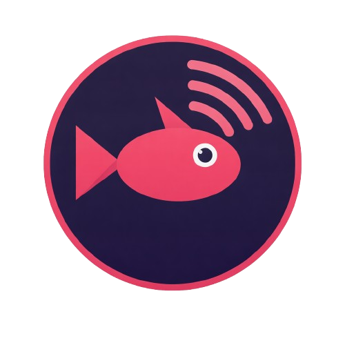

# TackleCast

<p align="center">
  
</p>

**A lightweight, GPU-accelerated capture card viewer for Windows and Linux.** No recording, no bloat, just your game on your screen.

Built for capture cards like the Genki ShadowCast, Elgato, AVerMedia, and other UVC-compliant devices. Written in Rust with a zero-copy GPU pipeline and low-latency audio passthrough.

## Features

- **GPU-accelerated rendering** via wgpu with a custom YUV-to-RGB shader
- **NVIDIA GPU MJPEG decode on Windows** via nvJPEG/CUDA (automatic fallback to software decode)
- **Zero-copy MJPEG pipeline on supported NVIDIA/Windows systems** - decoded frames stay on the GPU (CUDA to DX12 to wgpu)
- **Low-latency audio passthrough** via WASAPI (Windows) and ALSA, including PipeWire/PulseAudio compatibility plugins (Linux)
- **Robust audio resampling & channel conversion** - handles mono, stereo, and variable sample rates (e.g. PS4/PS5/Switch audio over USB capture cards)
- **Audio mute toggle & UI status** - mute control with real-time audio connection status
- **Cross-platform video capture** - DirectShow on Windows, V4L2 on Linux
- **Device-supported modes** - resolutions, pixel formats, and frame rates reported by the selected card, including fractional rates
- **Visible format negotiation** - Auto prefers NV12, then MJPEG at the selected resolution and FPS, and shows the format actually opened
- **Color controls** - metadata-aware color space and range, with explicitly labeled defaults and manual overrides
- **Live picture controls** - brightness, contrast, saturation, gamma, and reset
- **Live FPS counter** with separate nominal and delivered frame rates
- **Auto-detect capture cards** via DirectShow and V4L2
- **Four-tab settings** - Video, Picture, Audio, and Display, retaining the coral/navy theme
- **Fullscreen support** (F11 or toggle in settings)
- **Zero recording overhead** - purely a viewer
- **Settings persistence** - remembers your device selections
- **Diagnostic logging** - rotating log files for troubleshooting

## Quick Start

1. Download the latest release from [Releases](../../releases/latest).
   - **Windows**: Download `TackleCast-Windows-x86_64.zip`, extract anywhere, and double-click `TackleCast.exe`.
   - **Linux**: Download `TackleCast-Linux-x86_64.tar.gz`, extract (`tar -xzvf TackleCast-Linux-x86_64.tar.gz`), and run `./run.sh`.
2. Press **Escape** and choose your capture card under **Video**. Select a supported resolution and frame rate; leave Pixel Format on Auto or choose a supported format manually.
3. Close the menu with **Escape** to apply capture changes. Auto then shows the opened format, such as `Auto (NV12)`. Press **F11** for fullscreen.

FFmpeg is bundled on both platforms. Windows packages also include the CUDA/nvJPEG runtime; GPU decoding needs a compatible NVIDIA GPU and driver. Official Linux archives target x86_64 Ubuntu 24.04 or newer and use your desktop's ALSA and Vulkan/OpenGL drivers.

On Linux/X11, your desktop must also provide the X11 keyboard runtime. On Ubuntu/Debian, install it if needed with `sudo apt install libxkbcommon-x11-0`.

### PS4 audio and video

Connect the PS4's HDMI output to your capture card and the card to your PC over USB. For gameplay capture, clear **Settings > System > Enable HDCP** ([PlayStation guide](https://manuals.playstation.net/document/en/ps4/settings/hdcp.html)). Set **Settings > Sound and Screen > Audio Output Settings > Audio Format (Priority)** to **Linear PCM** ([PlayStation guide](https://manuals.playstation.net/document/en/ps4/settings/audiooutput.html)).

In TackleCast, press Escape and select the capture card's audio input and your speakers/headphones as output. Check that audio is Connected and unmuted. Mono input is duplicated to stereo, and different input/output sample rates are converted. For the widest capture-card compatibility, use stereo PCM; surround conversion assumes the conventional speaker order described in [BUILD.md](BUILD.md).

If sound is missing, check the selected input is the capture card rather than your microphone or desktop's default source, and inspect the input/output formats in `logs/`. Unit tests cover channel conversion and resampling; console-specific behavior still depends on the card and needs hardware validation.

## Building from Source

See [BUILD.md](BUILD.md) for platform dependencies, environment setup, tests, and packaging. After setting up the dependencies:

```bash
cargo build --release
```

## Controls

| Action | Key |
|---|---|
| Open/close settings | Escape |
| Fullscreen | F11 |

## Settings

Press **Escape** to open the four-tab menu. Shorter tabs keep the same menu size and position; small windows can scroll.

| Tab | Controls |
|---|---|
| Video | Capture device, supported resolution/FPS/format combinations, scaling filter, color space, and color range |
| Picture | Live brightness, contrast, saturation, and gamma adjustments, plus Reset Picture to Defaults |
| Audio | Input/output devices, mute, volume, and connection status |
| Display | Fullscreen, performance overlay, detailed scaling/color information, and Exit |

Picture, scaling, and color adjustments preview immediately. The backdrop clears while editing sliders or their numeric values so you can judge the live picture. Closing the menu saves the settings and applies capture/audio device changes.

The overlay separates the selected **nominal FPS** from **delivered FPS**. For example, a `59.94` nominal mode stays distinct from `60`, even when the short-term delivery counter is close to 60. Auto color labels include `default` when metadata is missing; manual overrides are available when the source's reported color information needs correcting.

## How It Works

TackleCast has a three-tier decode pipeline that automatically selects the best path for your hardware:

| Tier | Path | When |
|---|---|---|
| Zero-copy | nvJPEG decode to shared DX12 buffer to wgpu | NVIDIA GPU with CUDA support (Windows) |
| GPU decode + readback | nvJPEG decode to host memory to wgpu | CUDA available, DX12 interop unavailable |
| Software decode | ffmpeg CPU decode to wgpu | Linux or no CUDA/nvJPEG available |

Auto selects a format from the card's supported modes at the requested resolution and frame rate. It tries NV12 first, then MJPEG, then other supported formats. Manual format selections are strict; capture does not silently reduce resolution or frame rate. The menu shows the actual format after negotiation. The overlay distinguishes the nominal mode from measured frame delivery.

Color Auto follows stream/frame metadata. When metadata is missing, the UI labels the fallback as a default rather than presenting it as detected information. BT.2020 selects a conversion matrix; it does not implement HDR tone mapping.

## Architecture

```
src/
  main.rs          - winit event loop, app state, settings
  capture.rs       - DirectShow / V4L2 capture via ffmpeg-next, strict mode negotiation
  capabilities/    - Native DirectShow / V4L2 mode discovery
  frame_rate.rs    - Rational nominal frame rates
  color.rs         - Color metadata and explicit defaults
  gpu_decode.rs    - NVIDIA nvJPEG GPU MJPEG decode (feature-gated: gpu-decode)
  dx12_interop.rs  - DX12 shared buffers for CUDA/wgpu zero-copy (feature-gated: gpu-decode)
  render.rs        - wgpu DX12/Vulkan renderer, YUV->RGB WGSL shader
  audio/           - Audio passthrough via cpal (WASAPI on Windows, PipeWire/ALSA on Linux)
  devices.rs       - Cross-platform video + audio device enumeration
  settings.rs      - JSON settings load/save
  ui.rs            - egui overlay and settings menu
  logger.rs        - Rotating file logger via tracing
```

## Known Limitations

- **MJPEG GPU decoding requires Windows and a compatible NVIDIA GPU/runtime.** Linux and other GPUs use software decoding with the same wgpu rendering path.
- **Reported modes do not guarantee sustained throughput.** The HDMI source, USB connection, capture-card encoder, and PC can limit delivery. Capture cards and laptops may also throttle under sustained load; compare delivered FPS with nominal FPS in the overlay.
- **Linux physical capture needs broader hardware validation.** Native V4L2 discovery is implemented, and Linux tests, shader checks, and packaged synthetic rendering have passed. The latest ShadowCast hardware checks were performed on Windows.
- **FSR and HDR tone mapping are not included.** Scaling options are Bilinear, Bicubic, and Lanczos; BT.2020 is a color conversion matrix. Saved `fsr1` selections load as Bilinear while preserving other settings.
- Webcams may partially work but are not officially supported.

## Acknowledgments

- **[@NeverForgetful](https://www.youtube.com/@NeverForgetful)** - Testing and QA
- **[@ajmine03](https://github.com/ajmine03)** - Linux support and audio contributions
- **[@Vinny-TS](https://github.com/Vinny-TS)** - Capture settings, color controls, and settings UI contributions

## License

MIT
